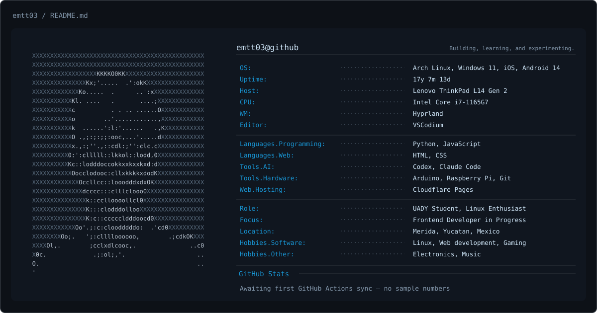

<!-- This profile README is shown at github.com/emtt03 when this repository is public. -->

<picture>
  <source media="(prefers-color-scheme: dark)" srcset="assets/dark_mode.svg" />
  <source media="(prefers-color-scheme: light)" srcset="assets/light_mode.svg" />
  
</picture>
